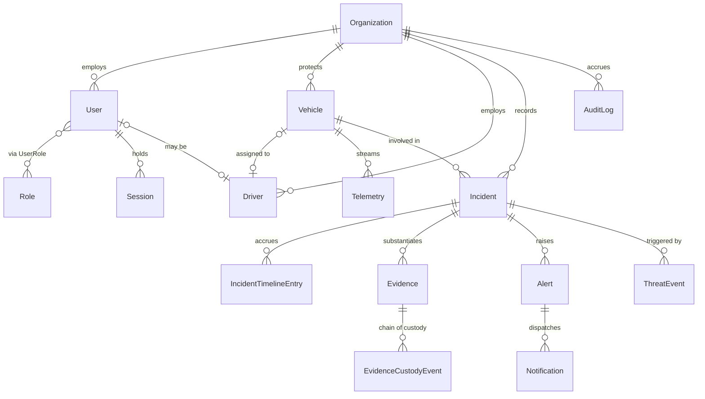

# Data model

Source of truth: [`apps/api/prisma/schema.prisma`](../../apps/api/prisma/schema.prisma).

This document explains the parts of that schema a reader could not infer from
the column names — the invariants, the denormalisations and the reasons for
them.

## Conventions

| Convention                                                | Reason                                                                                 |
| --------------------------------------------------------- | -------------------------------------------------------------------------------------- |
| UUID primary keys                                         | Sequential integers leak tenant volume and make cross-service references guessable     |
| `organizationId` on every tenant-owned row, indexed first | Row isolation is enforced in the repository layer; the compound indexes make that free |
| `createdAt` / `updatedAt` on every mutable model          | Debugging an incident six months later needs both                                      |
| `@@map` to snake_case table names                         | Postgres convention; Prisma models stay camelCase                                      |
| Enum values identical to `packages/types/src/enums.ts`    | A mismatch is a silent data bug, not a compile error                                   |

## Entity relationships



## Invariants worth knowing

### Append-only tables

Three tables have no update or delete path anywhere in the codebase, and must
not acquire one:

| Table                       | Why                                                    |
| --------------------------- | ------------------------------------------------------ |
| `audit_logs`                | An editable audit trail is not an audit trail          |
| `evidence_custody_events`   | A custody chain with a gap or an edit is inadmissible  |
| `incident_timeline_entries` | The operational record produced alongside the evidence |

The repositories for these expose `insert…` and `find…` only. That is the
enforcement — there is no ORM-level constraint stopping a future
`prisma.auditLog.update()`, so the absence of the method is doing the work.

### Email is unique per tenant, not globally

`@@unique([organizationId, email])`.

A security responder may legitimately hold accounts with two client
organisations. A global unique constraint would force them to invent a second
email address, which in practice means a shared inbox and a shared credential.

Consequence: `findCredentialsByEmail` uses `findFirst`, not `findUnique`, and
login is ambiguous if the same address exists in two tenants. Resolving that
ambiguity — a tenant selector on login — is not yet built.

### Vehicle position is denormalised

`Vehicle` carries `lastLongitude`, `lastLatitude`, `lastHeading`, `lastSpeedKph`
and `lastSeenAt`, all of which are also in `Telemetry`.

The authoritative history is `Telemetry`. These columns exist so the fleet map
renders 500 vehicles without 500 correlated subqueries against the largest table
in the system.

They are written on the ingest path by `updateLastPosition`, and **only when the
incoming frame is newer than the stored `lastSeenAt`**. A late-arriving frame
from a device that was in a coverage gap is still stored as history — that is
exactly what forensic replay needs — but it must not drag the live position
backwards.

### Incident references are allocated in a serialisable transaction

`INC-2026-000481` is unique per tenant per year. `allocateReference` reads the
highest existing reference and increments it inside a `Serializable`
transaction, because two incidents detected in the same millisecond would
otherwise be handed the same number.

Volume is tens per day per tenant, so the serialisation cost is irrelevant. At
much higher volume this becomes a sequence per tenant.

### `sizeBytes` is a `BigInt`

Evidence video can exceed 2 GB. The column is `BigInt` and the mapper narrows it
to `Number` for the wire, because `BigInt` has no JSON representation. The
narrowing is lossless below 9 petabytes.

### Telemetry index order is deliberate

```prisma
@@index([vehicleId, recordedAt(sort: Desc)])
```

The dominant query is "the latest N points for one vehicle". Leading with
`vehicleId` and descending on `recordedAt` lets that be an index-only range scan
from the head. The reverse order would force a sort on every read.

## The table that will need attention first

`telemetry`. A 500-vehicle fleet reporting every five seconds writes roughly
**8.6 million rows a day**.

Current mitigation is `services/telemetry`, which deletes past the
30-day hot-retention cutoff in bounded batches — bounded specifically so a
single large `DELETE` cannot hold locks and stall ingest, which is the one path
that must never stop.

Not yet built, and needed before real volume:

1. **Daily per-vehicle rollups**, so history survives the deletion.
2. **Native partitioning** by month, making retention a `DROP PARTITION`
   instead of a delete sweep.
3. **A separate connection pool** for ingest, so a burst cannot exhaust the
   pool the console depends on.

## Cascade behaviour

| Relation                    | On delete | Reason                                                                        |
| --------------------------- | --------- | ----------------------------------------------------------------------------- |
| `Organization` → everything | `Cascade` | Tenant offboarding must actually remove the data                              |
| `User` → `Session`          | `Cascade` | A deleted account must not leave live sessions                                |
| `Incident` → `Evidence`     | `SetNull` | Evidence outlives the incident it was attached to                             |
| `Vehicle` → `Incident`      | `SetNull` | Deleting a vehicle must not erase its incident history                        |
| `User` → `AuditLog`         | `SetNull` | The trail survives the account; `actorEmail` is denormalised for exactly this |

The `SetNull` choices are the ones to understand: they encode that the
_historical record_ outranks the entity it points at.
